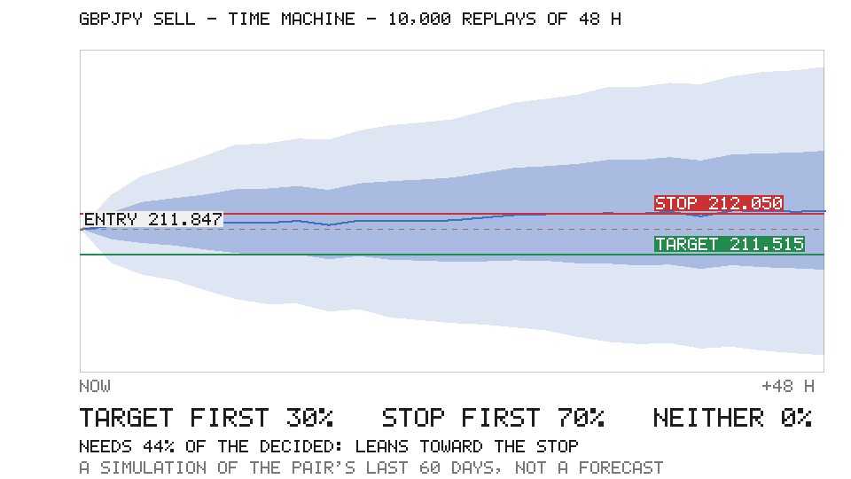

# PAPER FORWARD TEST — NOT REAL MONEY

Updated 2026-11-11 06:18 UTC · mode `PAPER_FORWARD` · profile `PAPER-FORWARD-200K` · shift started 2026-11-11 03:17 UTC · decision system `dual_ai`

Research status (historical, unchanged): **NO EDGE — DO NOT TRADE (historical research; this test measures forward)**. This run measures the system forward; it is not evidence of an edge until it has a sample and the forward-eligibility rules say so.

## ملخص بالعربي

- الحساب الجديد (من 2026-11-01 22:00 UTC): الرصيد $199,348.96، الربح أو الخسارة $-651.04، صفقات مسكّرة 3 ($-651.04)، مفتوحة 0.
- الحساب الكامل من البداية: $191,933.98.
- آخر قرار: GBPJPY لا صفقة (اتفقوا بس مو الاثنين واثقين 65 أو أكثر).
- المتداول الكبير (‎claude-opus-5.5‎، مدفوع): رفض 5، ما جاوب 0؛ حكم بالظل على 71 اتفاق تحت الحد ووافق على 0؛ صرف $7.84 من $95.00.
- آلة الزمن لآخر اتفاق (GBPJPY، 10000 إعادة): الهدف أول 30%، الستوب أول 70%، ولا واحد 0%: يميل للستوب.
- حساب ورقي للاختبار، مو فلوس حقيقية. التفاصيل الكاملة بالإنكليزي تحت.

## The new account: the setup trading now (from 2026-11-01 22:00 UTC)

dual-ai 1.12.0 and on: the H1 chart, held up to 48 h (1.11.0); a trade only when both traders state a confidence of 65 or more (1.12.0); the traders read the desk's journal (1.13.0); Trader 2 on another lab's model (1.14.0); the record analysed (1.15.0); the time machine (1.16.0); on the free models (the paid trial ended 2026-10-31 00:00 UTC). Opened at the owner's request (2026-10-31): owner: a longer timeframe and only very confident entries; a new account for the new setup, as the owner chose on 2026-10-27; the accounts before it are kept and reported apart.

| Start | Equity | Total P&L | Closed | Open | Trades | Win rate | Expectancy | Profit factor |
|---|---|---|---|---|---|---|---|---|
| $200,000.00 | $199,348.96 | $-651.04 | $-651.04 | 0 ($0.00) | 3 (insufficient) | 0.0% | -0.904R | 0.00 |

Before it, kept and apart (not in the figures above): 137 trades, net $-7,414.98. The whole paper journal, which the hard gate and the risk engine still guard, is under Paper account below; nothing in it was moved or removed.

## The rule that trades: a trade only when both AIs agree

| Trades | Wins | Losses | Win rate | Net P&L | Expectancy | Profit factor | Max drawdown |
|---|---|---|---|---|---|---|---|
| 140 (adequate) | 54 | 86 | 38.6% | $-8,066.02 | -0.140R | 0.72 | $11,341.92 |

The 4 trade(s) of the old DEBATE rule, stopped in dual-ai-1.2.0, were removed from the paper account at the operator's request: their net $-1,416.51 was put back by a declared adjustment ($1,416.51). They stay in the journal (append-only), in none of the account's figures below.

## Paper account

| Account | Equity | P&L today | Total P&L | Drawdown | Open | Trades | Win rate | Expectancy | Profit factor | Risk | Bot |
|---|---|---|---|---|---|---|---|---|---|---|---|
| $200,000.00 | $191,933.98 | $0.00 | $-8,066.02 | $-8,066.02 | 0 | 140 (adequate) | 38.6% | -0.140R | 0.72 | ACTIVE | RUNNING |

Equity includes declared operator adjustments of $1,416.51 (without them: $190,517.46); P&L today excludes them. `remove-retired-debate-rule-trades-2026-10-15`: operator: the 4 trades of the retired debate rule (dual-ai 1.1.0, stopped in 1.2.0) are removed from the paper account; they stay in the journal.

## Who lost it: the market or us

Losses 86, $-28,467.85: **the market 86** (at the stop, within the plan 78, by the time exit 6, stopped beyond the plan (a gap or the spread at the stop) 2) · **us 0**. Every closed trade is checked: the rules and the gate approved it, its data and the fill's quote were fresh, it was sized within the per-trade risk, both traders chose its side, it closed on time and not over a weekend, its costs were as planned. A check that cannot be read counts as ours.

Beyond the plan, the market's: 10-21 21:05 GBPJPY BUY lost $644.82 against a planned $498.95 in the rollover.

Beyond the plan, the market's: 10-28 13:35 GBPUSD SELL lost $509.02 against a planned $489.30.

The 4 trade(s) taken out of the account, checked the same way: 4 ours (DESK: not both traders' choice (rule DEBATE, traders ['BUY', 'SELL'])).

## Last decisions (decision → risk → paper execution)

- 11-02 11:34 EURGBP SELL: AI DECISION → RISK REJECTED — cost_to_risk: round-trip cost is 27.6% of the stop (max 25%): spread 0.00012 + commission and slippage
- 11-02 11:17 USDCHF SELL: AI DECISION → RISK REJECTED — reward_risk: 0.61 vs minimum 1.2
- 11-02 08:00 EURUSD SELL: AI DECISION → RISK APPROVED → PAPER EXECUTED
- 11-02 07:35 GBPJPY SELL: AI DECISION → RISK APPROVED → PAPER EXECUTED
- 11-02 05:45 NZDUSD SELL: AI DECISION → RISK APPROVED → PAPER EXECUTED
- 10-30 07:30 GBPUSD BUY: AI DECISION → RISK APPROVED → PAPER EXECUTED
- 10-30 06:36 USDCHF SELL: AI DECISION → RISK APPROVED → PAPER EXECUTED
- 10-30 06:17 AUDUSD SELL: AI DECISION → RISK REJECTED — quote: age 100s at opening (max 90s), bid 0.70305, ask 0.7031499999999999
- 10-30 06:00 GBPUSD SELL: AI DECISION → RISK REJECTED — currency_conflict: SELL GBPUSD would bet against an open position: EURGBP SELL is long GBP
- 10-30 04:45 USDJPY SELL: AI DECISION → RISK APPROVED → PAPER EXECUTED
- 10-30 04:30 GBPUSD SELL: AI DECISION → RISK REJECTED — currency_conflict: SELL GBPUSD would bet against an open position: EURGBP SELL is long GBP
- 10-30 04:00 NZDUSD SELL: AI DECISION → RISK REJECTED — cost_to_risk: round-trip cost is 27.4% of the stop (max 25%): spread 0.00015 + commission and slippage
- 10-30 03:15 GBPUSD BUY: AI DECISION → RISK APPROVED → PAPER EXECUTED
- 10-30 03:00 EURCHF SELL: AI DECISION → RISK APPROVED → PAPER EXECUTED
- 10-30 02:30 NZDUSD SELL: AI DECISION → RISK REJECTED — cost_to_risk: round-trip cost is 32.2% of the stop (max 25%): spread 0.00015 + commission and slippage
- 10-30 02:16 USDCHF SELL: AI DECISION → RISK REJECTED — quote: age 128s at opening (max 90s), bid 0.821125, ask 0.8212750000000001
- 10-30 02:15 USDCAD SELL: AI DECISION → RISK REJECTED — quote: age 94s at opening (max 90s), bid 1.396525, ask 1.396675
- 10-30 01:00 EURGBP SELL: AI DECISION → RISK APPROVED → PAPER EXECUTED
- 10-29 17:02 GBPJPY BUY: AI DECISION → RISK APPROVED → PAPER EXECUTED
- 10-29 17:00 EURJPY BUY: AI DECISION → RISK REJECTED — reward_risk: 1.19 vs minimum 1.2; currency_conflict: BUY EURJPY would bet against an open position: EURUSD SELL is short EUR

## Latest decisions, NO TRADE included (5782 so far)

- 11-11 06:02 GBPJPY NO_TRADE: both traders chose SELL, but not both at 65 or more (Trader 1 58, Trader 2 55): no trade unless both are that sure; followed forward in shadow, not traded
- 11-11 06:00 EURJPY NO_TRADE: both traders chose SELL, but not both at 65 or more (Trader 1 50, Trader 2 55): no trade unless both are that sure; followed forward in shadow, not traded
- 11-11 05:46 EURGBP NO_TRADE: both traders chose BUY, but not both at 65 or more (Trader 1 54, Trader 2 55): no trade unless both are that sure; followed forward in shadow, not traded
- 11-11 05:45 NZDUSD NO_TRADE: Trader 2's model gave no usable answer (HTTP_400: HTTP 400: Provider returned error {"code":400,"msg":"bad request","request_id":"b2f84cc9-9ac3-4028-88bf-8997b311c8c3"}): nobody stands in for it, and 
- 11-11 05:32 USDCHF NO_TRADE: Trader 2's model gave no usable answer (HTTP_400: HTTP 400: Provider returned error {"code":400,"msg":"bad request","request_id":"0e9707fe-a89d-4119-b275-5490700b4b77"}): nobody stands in for it, and 
- 11-11 05:30 USDCAD NO_TRADE: both traders chose SELL, but not both at 65 or more (Trader 1 57, Trader 2 60): no trade unless both are that sure; followed forward in shadow, not traded
- 11-11 05:15 AUDUSD NO_TRADE: the traders disagree (Trader 1 BUY 45, Trader 2 SELL 65): no trade unless both choose the same side; the debate (nvidia/nemotron-3-nano-omni-30b-a3b-reasoning:free) would have chosen BUY: followed for
- 11-11 05:15 USDJPY NO_TRADE: Trader 2's model gave no usable answer (HTTP_400: HTTP 400: Provider returned error {"code":400,"msg":"bad request","request_id":"82832a40-e056-42a0-9f54-4a8930778919"}): nobody stands in for it, and 
- 11-11 05:01 GBPUSD NO_TRADE: the traders disagree (Trader 1 BUY 55, Trader 2 SELL 62): no trade unless both choose the same side; the debate (nvidia/nemotron-3-nano-omni-30b-a3b-reasoning:free) would have chosen SELL: followed fo
- 11-11 05:00 EURUSD NO_TRADE: Trader 2's model gave no usable answer (HTTP_400: HTTP 400: Provider returned error {"code":400,"msg":"bad request","request_id":"ebe46453-7cdc-4715-9d79-4f55b65528dd"}): nobody stands in for it, and 
- 11-11 04:50 AUDJPY NO_TRADE: both traders chose SELL, but not both at 65 or more (Trader 1 58, Trader 2 58): no trade unless both are that sure; followed forward in shadow, not traded
- 11-11 04:45 EURCHF NO_TRADE: the traders disagree (Trader 1 BUY 50, Trader 2 SELL 58): no trade unless both choose the same side; the debate (nvidia/nemotron-3-nano-omni-30b-a3b-reasoning:free) would have chosen SELL: followed fo

## Open paper positions

| Symbol | Side | Qty | Entry | Stop | Target | P&L |
|---|---|---|---|---|---|---|

## Closed paper trades (latest 20)

| Closed | Symbol | Side | Net | R | Costs | Exit | Source | Rule | Lost to |
|---|---|---|---|---|---|---|---|---|---|
| 11-02 09:01 | GBPJPY | SELL | $-211.35 | -0.88 | $20.89 | STOP | DUAL_AI | AGREE | the market |
| 11-02 08:46 | NZDUSD | SELL | $-221.30 | -0.92 | $24.48 | STOP | DUAL_AI | AGREE | the market |
| 11-02 08:35 | EURUSD | SELL | $-218.38 | -0.91 | $25.67 | STOP | DUAL_AI | AGREE | the market |
| 10-30 20:00 | EURCHF | SELL | $-124.56 | -0.52 | $30.34 | TIME | DUAL_AI | AGREE | the market |
| 10-30 13:46 | GBPUSD | BUY | $-444.37 | -0.92 | $37.38 | STOP | DUAL_AI | AGREE | the market |
| 10-30 13:50 | USDCHF | SELL | $-103.41 | -0.87 | $12.71 | STOP | DUAL_AI | AGREE | the market |
| 10-30 07:24 | EURGBP | SELL | $566.51 | +1.17 | $78.92 | TARGET | DUAL_AI | AGREE | - |
| 10-30 05:23 | USDJPY | SELL | $-203.12 | -0.85 | $19.07 | STOP | DUAL_AI | AGREE | the market |
| 10-30 03:45 | GBPUSD | BUY | $-201.68 | -0.84 | $30.66 | STOP | DUAL_AI | AGREE | the market |
| 10-30 03:12 | GBPJPY | BUY | $-462.07 | -0.95 | $43.29 | STOP | DUAL_AI | AGREE | the market |
| 10-30 02:07 | NZDUSD | SELL | $-440.75 | -0.91 | $100.15 | STOP | DUAL_AI | AGREE | the market |
| 10-29 20:34 | EURUSD | SELL | $-432.21 | -0.89 | $35.19 | STOP | DUAL_AI | AGREE | the market |
| 10-29 13:31 | AUDJPY | BUY | $-417.64 | -0.86 | $64.29 | STOP | DUAL_AI | AGREE | the market |
| 10-29 13:18 | EURUSD | SELL | $300.12 | +1.24 | $29.28 | TARGET | DUAL_AI | AGREE | - |
| 10-29 12:58 | EURGBP | SELL | $444.04 | +0.91 | $82.93 | TARGET | DUAL_AI | AGREE | - |
| 10-29 10:03 | NZDUSD | BUY | $-237.99 | -0.98 | $44.54 | STOP | DUAL_AI | AGREE | the market |
| 10-29 06:01 | AUDUSD | BUY | $-422.22 | -0.87 | $71.63 | STOP | DUAL_AI | AGREE | the market |
| 10-29 01:54 | GBPJPY | BUY | $-417.01 | -0.86 | $62.67 | STOP | DUAL_AI | AGREE | the market |
| 10-29 01:51 | EURCHF | SELL | $264.71 | +1.09 | $60.23 | TARGET | DUAL_AI | AGREE | - |
| 10-29 01:25 | USDCAD | SELL | $169.74 | +1.40 | $27.33 | TARGET | DUAL_AI | AGREE | - |

## Dual AI desk (two OpenRouter traders: free, or the paid trial while it runs; a trade only when they agree, both at 65 or more)

OpenRouter `READY` · key set · trader 1 `nvidia/nemotron-3.5-super-vl:free` · trader 2 `dots-studio/dots-3-note-preview:free` · debate `nvidia/nemotron-3-nano-omni-30b-a3b-reasoning:free` · calls today 60/900

Paid trial `senior-2026-11-04` (2026-11-02T15:00:00Z to 2026-12-01T00:00:00Z): ACTIVE · the senior `anthropic/claude-opus-5.5` (paid only) · spent $7.84 of $95.00, today $0.00 of $7.50 (the key's own reading)

Agreement trades 140 (adequate) · wins 54 · losses 86 · net $-8,066.02 · expectancy -0.140R · profit factor 0.72 · old DEBATE rule (stopped in dual-ai-1.2.0): 4 trade(s), net $-1,416.51, removed from the account

Disagreements (not traded; the debate runs in shadow): 250 · the debate's pick if taken: 200 resolved (adequate), expectancy -0.087R · the side it rejected if taken: 205 resolved (adequate), expectancy -0.202R

Exits in shadow (the same trades, followed again; measured, never traded): break-even at +1R -0.203R vs -0.175R as taken (127, adequate) · closed at 24 h none resolved yet · held 24 h (before forward 1.3.0) -0.116R vs -0.175R as taken (127, adequate) · stop and target twice as far -0.062R vs -0.175R as taken (127, adequate) · closed at 8 h (the exit before dual-ai 1.7.0) -0.335R vs -0.315R as taken (73, adequate)

Trader 2's own levels in shadow (a trade is on Trader 1's since dual-ai 1.10.0; measured, never traded): -0.309R vs -0.334R as taken (34, adequate)

Agreements below the confidence floor (both traders at 65 or more since dual-ai 1.12.0; not traded, followed forward as the trades they would have been): 558 · if taken: 404 resolved (adequate), expectancy -0.062R

Trades taken by session (UTC): ASIA 61 resolved (adequate), expectancy -0.270R · LONDON 44 resolved (adequate), expectancy -0.078R · OVERLAP 8 resolved (insufficient), expectancy -0.382R · NEW_YORK 28 resolved (insufficient), expectancy +0.050R · LATE 3 resolved (insufficient), expectancy -1.106R

Agreements the senior trader did not approve (dual-ai 1.18.0; vetoed, or no usable answer; not traded, followed forward): 5 vetoed · 0 without a usable review · if taken: 5 resolved (insufficient), expectancy +0.184R

| Time | Symbol | Trader 1 | Trader 2 | Debate (shadow) | Senior | Rule | Final | Risk | Time machine |
|---|---|---|---|---|---|---|---|---|---|
| 11-11 06:02 | GBPJPY | SELL 58 | SELL 55 | - | -  | LOW_CONFIDENCE | NO_TRADE | - | T 30% / S 70% / - 0%: leans toward the stop |
| 11-11 06:00 | EURJPY | SELL 50 | SELL 55 | - | -  | LOW_CONFIDENCE | NO_TRADE | - | T 35% / S 65% / - 0%: leans toward the stop |
| 11-11 05:46 | EURGBP | BUY 54 | BUY 55 | - | -  | LOW_CONFIDENCE | NO_TRADE | - | T 26% / S 74% / - 0%: strongly toward the stop |
| 11-11 05:45 | NZDUSD | SELL 52 | -  | - | -  | TRADER2_UNAVAILABLE | NO_TRADE | - | - |
| 11-11 05:32 | USDCHF | SELL 55 | -  | - | -  | TRADER2_UNAVAILABLE | NO_TRADE | - | - |
| 11-11 05:30 | USDCAD | SELL 57 | SELL 60 | - | -  | LOW_CONFIDENCE | NO_TRADE | - | T 55% / S 45% / - 0%: close to break-even |
| 11-11 05:15 | AUDUSD | BUY 45 | SELL 65 | BUY | -  | DISAGREE | NO_TRADE | - | - |
| 11-11 05:15 | USDJPY | BUY 60 | -  | - | -  | TRADER2_UNAVAILABLE | NO_TRADE | - | - |
| 11-11 05:01 | GBPUSD | BUY 55 | SELL 62 | SELL | -  | DISAGREE | NO_TRADE | - | - |
| 11-11 05:00 | EURUSD | BUY 55 | -  | - | -  | TRADER2_UNAVAILABLE | NO_TRADE | - | - |
| 11-11 04:50 | AUDJPY | SELL 58 | SELL 58 | - | -  | LOW_CONFIDENCE | NO_TRADE | - | T 39% / S 61% / - 0%: close to break-even |
| 11-11 04:45 | EURCHF | BUY 50 | SELL 58 | SELL | -  | DISAGREE | NO_TRADE | - | - |

The chart Trader 1 read last: `last_chart.png`. (numbers): until dual-ai 1.17.0, when no free vision model answered, Trader 1 read the same chart from its numbers on another model.

Time machine of the latest agreement (GBPJPY): the levels replayed 10,000 times on the pair's own last 60 days of hours; a simulation of the recent past, not a forecast, and it refuses nothing (dual-ai 1.16.0).

Full figures: `paper_forward.json`. Rules: `docs/PAPER_FORWARD.md` on main.
